# 弦刃 Resonant

**2D 横版节奏动作 Demo / V1.0**

> 以剑为乐器，以敌人为音符，以战斗谱写乐章。

这是一个可以直接从头玩到 Boss 结算的 Godot 4 项目。没有外部美术、字体或音频素材：
场景、角色、敌人、Boss、特效全部由代码绘制；七条音乐 stem 和三十多个音效由
`tools/gen_audio.py` 从零合成。

Demo 的核心是**命中帧判定的节奏战斗**，而不是在动作游戏外面套一层音游 UI：

- 攻击随时可以发动，但只有**剑真正碰到敌人的瞬间**才结算 PERFECT / GREAT / GOOD。
- 清场后要用节拍攻击**共鸣封印**，才能找回一个声部、打开下一段回廊。
- 四个声部会在**下一个小节边界**逐层进入，音乐从一条节拍长成完整乐章。
- Boss 的指挥棒把攻击写在拍点上；第二阶段故意改变时值，第三阶段只暴露核心。
- 最终演奏要求把快速斩击、音波突刺、挑空攻击、低音重击分别放进四个拍点。
- 成功则所有轨道汇合、进入「完美乐章」；失败仍然通关，但乐章不完整。

---

## 第一次玩，从这里开始

**不用先读完整篇文档。** 第一次点「开始演奏」会自动进入 6 步互动教学；
也可以随时从菜单选择「玩法教学」重玩。

1. **移动/跳跃**：`A` `D` 移动，`W` 跳跃。
2. **四种攻击**：`K` 快速斩击、`J` 低音重击、`L` 音波突刺、`I` 挑空攻击。
3. **最重要的一条**：按攻击键本身不计拍；**剑真正碰到敌人的瞬间**才与音乐节拍比较。
   所以要在拍点到来之前提前按。
4. **闪避**：`Shift`，有无敌帧，可以穿过红色的 Boss 攻击。
5. **推进**：清空区域 → 在节拍上攻击共鸣封印 → 打开前路、恢复一个音乐声部。
6. **Boss**：先打暴露的核心；Boss 倒下后按 `K → L → I → J` 完成终章四击。

教学会检查你实际完成了什么，而不是只放一张说明图。若你跳过教学：
`Enter` 跳过；以后仍可在菜单里重看。

**视频教程**：
[▶ 24 秒互动教学录像](docs/resonant_tutorial.avi)
·
[▶ 28 秒完整机制展示](docs/resonant_demo.avi)

---

## 运行

**需要 Godot 4.x**。开发和验证使用的是 **4.7.2.stable**（Windows）。

```powershell
& "D:\steam\steamapps\common\Godot Engine\godot.windows.opt.tools.64.exe" `
    --path "D:\Users\32747\Documents\deepseek-harness\default-workspace\Resonant"
```

也可以直接用 Godot 打开 `project.godot` 后按 F5。

命令行快速启动 / 截图：

```powershell
# 直接进入游戏
godot --path . -- --autostart

# 直接进入互动教学
godot --path . -- --tutorial

# 进入游戏并在教学提示淡出后截图（输出到 screenshots/）
godot --path . -- --autostart --capture=game --quit-after-capture

# 28 秒脚本化展示
godot --path . -- --demo
```

> 工程内没有提交导出后的 exe：本机没有安装 Godot export templates。
> 项目本身完整可运行，导出时在 Godot 的 Project → Export 里添加 Windows 预设即可。

### 仓库说明

- 本仓库是源码仓库，不包含 `.godot/` 导入缓存；首次用 Godot 打开会自动导入音频；
- 两段实机视频在 `docs/` 下，直接下载观看；
- 如果要把项目打成单文件分发，可以在本地将整个目录打成 zip（视频较大，注意平台单文件限制）。

---

## 操作

| 按键 | 动作 |
|---|---|
| `A` / `D` | 左右移动 |
| `W` | 跳跃（带土狼时间与输入缓冲） |
| `Shift` | 闪避（0.26s 无敌帧，可空中闪避一次） |
| `K` | 快速斩击（三连斩） |
| `J` | 低音重击（破防；命中停顿与震屏最明显） |
| `L` | 音波突刺（中距离突进，接近/追击） |
| `I` | 挑空攻击（对空、击飞） |
| `Esc` | 暂停 / 继续 |
| `↑` `↓` + `Enter` | 菜单选择 / 确认 |

**菜单**：开始演奏、玩法教学、音频校准、操作说明、退出。
**暂停**：继续、音频校准、重新开始、返回标题。

---

## 节奏判定

BPM 固定为 **120**，一拍 `0.5s`，一小节 `2.0s`。评价取**命中时间**与最近拍点的偏差：

| 偏差 | 评价 | 权重 |
|---|---|---|
| ≤ 50 ms | **PERFECT** | 1.00 |
| ≤ 100 ms | **GREAT** | 0.78 |
| ≤ 180 ms | **GOOD** | 0.50 |
| > 180 ms | 普通 | 0.08 |

- 所有攻击不要求踩拍才能发动；只有命中结算节奏。
- 前摇越长，越需要提前输入：低音重击前摇 `0.27s`，快速斩击只有 `0.06s`。
- 普通命中不中断连击，只拉低准确度。
- 落空会让连击更快冷却；受击会直接中断连击。
- 音效永远在命中帧即时播放，不会为了等拍点而延迟。
- 判定时钟来自真实音频播放时间，而不是每帧重置的 Timer：

```text
song_time = master.get_playback_position()
          + AudioServer.get_time_since_last_mix()
          - AudioServer.get_output_latency()
judge_time = song_time + Settings.offset_ms / 1000
```

暂停时所有 stem 的 `stream_paused` 与游戏树一起冻结；恢复后从原位置继续。

---

## 音频校准

菜单或暂停中进入「音频校准」：

1. 跟随 8 次节拍点击轻按 `W`；
2. 系统取点击相位的**中位数**，建议一个反向偏移；
3. `←` / `→` 以 5ms 微调，`R` 重测；
4. `Enter` 应用并写入 `user://resonant_settings.cfg`。

如果 `user://` 不可写（例如受限沙箱），设置只在本次进程内生效，不会崩溃。

---

## 战斗与音乐

### 四种攻击

| 攻击 | 前摇 | 有效帧 | 后摇 | 用途 |
|---|---:|---:|---:|---|
| 快速斩击 `K` | 0.06 | 0.10 | 0.15 | 三连击、快速积累连击 |
| 低音重击 `J` | 0.27 | 0.12 | 0.46 | 破重拍守卫护甲、强反馈 |
| 音波突刺 `L` | 0.105 | 0.12 | 0.27 | 冲刺接近、中距离 |
| 挑空攻击 `I` | 0.155 | 0.13 | 0.335 | 击飞、对空 |

命中反馈链：命中特效、方向性火花、伤害数字、对应音效、局部 hit-stop、
不同力度的屏幕震动、敌人受击/后退/击飞/破防动作。

### 四种音符敌人

| 敌人 | 行为 | 教学点 |
|---|---|---|
| 音符兽 | 快速接近、短前摇扑击 | 基础连击与走位 |
| 重拍守卫 | 正面护甲，蓄力震地 | 闪避后 `J` 破防 |
| 高音精灵 | 空中保持距离、发射音符弹 | 跳跃/突刺接近，可切弹 |
| 失谐者 | 前摇时值随机偏移、快速突进 | 观察动作而不是背节拍 |

### 四层音乐

`level_pulse` → `level_bass` → `level_melody` → `level_harmony`

- 开场只有节拍层。
- 第一座共鸣封印（3 个 GOOD 以上命中）恢复低音与鼓组。
- 第二座（2 次节拍上的 `J` 破防）恢复主旋律。
- 第三座（3 种不同攻击落在节拍上）恢复和声与高音。
- 每层在**下一个小节线**淡入，避免在乐句中间突然拼接。
- Boss 战使用独立的 `boss_pulse / boss_lead / boss_coda`，同一 120 BPM、32 小节。
- 终章 4/4 后 `boss_coda` 在下一小节汇入，全部轨道同时鸣响。

音频全部是程序合成，`python tools/gen_audio.py` 可重新生成，依赖只有 numpy。

---

## 关卡：第一乐章 · 失序回廊

一条约 8.4k 像素的横向关卡，无读盘分段：

| 区域 | 内容 | 音乐目标 |
|---|---|---|
| I. 找回节拍 (0–1900) | 3 音符兽、教学平台 | 清场 + 3 次节拍命中 → 低音 |
| II. 建立旋律 (1900–4100) | 音符兽、重拍守卫、高音精灵 | 2 次节拍 `J` 破防 → 主旋律 |
| III. 失序区域 (4100–6600) | 守卫、失谐者、精灵混编 | 3 种攻击的节拍封印 → 和声 |
| IV. 终章 (6600–8400) | 失序指挥家 | 核心窗口 + 四击终章 |

每段清场后出现**共鸣封印**；封印不会因为多杀怪自动完成，乱按无法解锁声部。
玩家死亡后从最近检查点复活，死亡次数计入结算，但不会中断整段演出。

### Boss：失序指挥家

- **第一阶段 · 指挥**：固定拍点起手，震地 / 横扫 / 音符琶音，攻击后有反击窗口。
- **第二阶段 · 变奏**：时值变为 1.5 拍、半拍收招、震地后接横扫；必须看动作。
- **第三阶段 · 终章**：身体无敌，每两次攻击后核心暴露 4 拍；只有核心能受伤。
- **最终演奏**：HP 归零后进入四击序列，`K → L → I → J` 每击之间间隔 2 拍，
  需要根据前摇提前出手，让**命中帧**落在拍点上。
  - 4/4：完美终章，coda 加入，所有轨道汇合。
  - 少于 4：仍然击败 Boss，进入普通结局。

---

## 完美乐章

结算的 S 级需要同时满足：

- 击败 Boss；
- 四层声部全部恢复；
- 4 枚关键音符全部找回；
- 终章演奏 4/4；
- 节奏准确度 ≥ 68%；
- 最大连击 ≥ 12；
- 四种攻击都至少命中一次。

普通通关和完美演奏的区别不只在分数：完美终章会启用 `boss_coda`、金色终章演出、
S 级结算和独立的「PERFECT PERFORMANCE」标记。

---

## 视觉

所有可见元素都是 `_draw()` / `draw_*` 程序绘制：

- 调律者：长外套、围巾、面罩、发光长刃、程序化斩击轨迹。
- 音符兽：带符尾与符干的圆形音符精怪。
- 重拍守卫：塔盾、重甲、蓄力破绽。
- 高音精灵：带翼的升号/高音精灵。
- 失谐者：抖动、碎片和随机时值。
- 失序指挥家：高礼帽式面具、四臂残影、燕尾服、指挥棒、核心。
- 背景：视差星屑、五线谱、光带、管风琴、破碎拱门、玫瑰窗。

---

## 实机视频

| 视频 | 内容 |
|---|---|
| [▶ `docs/resonant_tutorial.avi`](docs/resonant_tutorial.avi) | **24 秒互动教学**：移动、W 跳跃、四种攻击、命中判定、闪避，全部由真实教程检查驱动 |
| [▶ `docs/resonant_demo.avi`](docs/resonant_demo.avi) | **28 秒机制展示**：连击、重击破防、Boss 三阶段、终章 4/4、完美结算 |

两段都由 Godot Movie Maker 在 **1280×720 @ 30fps** 下从实际游戏画面录制。
教学视频使用 `--tutorial-demo`，展示视频使用 `--demo`；镜头会在区域间瞬移以压缩时长，
移动、攻击、命中、音乐切换与教程判定仍走真实游戏系统。

---

## 测试

测试跑在 headless Godot 上。当前 **141 checks，0 failures**。

```powershell
$godot = "D:\steam\steamapps\common\Godot Engine\godot.windows.opt.tools.64.exe"
$proj  = "D:\Users\32747\Documents\deepseek-harness\default-workspace\Resonant"

& $godot --headless --path $proj res://tests/TestRunner.tscn
```

覆盖内容包括：

- 节拍数学与所有判定边界；
- 攻击配置不变量；
- 连击、准确度、层解锁、完美条件、评级；
- 七个 stem 的加载、长度一致与循环标记；
- 平台碰撞体数量；
- 输入移动/跳跃、重击命中、暂停/恢复；
- 首次进入互动教学、W 键绑定、六步教程推进、跳过/完成后开门；
- 真实清场 → 封印出现 → 打开大门；
- 三种封印要求；
- 守卫护甲与重击破防；
- 闪避无敌帧、死亡与检查点复活；
- Boss 三阶段、琶音弹幕、终章四击与结算。

无头测试使用 dummy 音频；实际混音与手感仍需人工试听/试玩。

---

## 目录

```
project.godot
scenes/Main.tscn
scripts/main.gd                     menu ↔ run ↔ pause ↔ calibration ↔ results
scripts/core/                       rhythm, conductor, settings, state, events, audio
scripts/data/game_config.gd         ALL combat timing / enemy / boss tuning
scripts/player/player.gd            movement + four attack lifecycles + procedural draw
scripts/enemies/                    config-driven enemies + cuttable note projectiles
scripts/boss/boss.gd                three phases + core + final performance
scripts/world/                      level geometry, gates, seals, training dummy
scripts/ui/                         menu, HUD, tutorial, pause, calibration, help, results
scripts/fx/                         one-node vector FX layer + shake camera
scripts/tools/demo_director.gd      28s showcase driver (--demo)
scripts/tools/tutorial_director.gd  24s tutorial driver (--tutorial-demo)
tools/gen_audio.py                  numpy synthesis for all music + SFX
tests/TestRunner.tscn               141-check headless suite
docs/DESIGN.md                      detailed design + acceptance mapping
docs/DEVLOG.md                      implementation notes / known gaps
docs/resonant_tutorial.avi          24s interactive tutorial capture (1280x720 30fps)
docs/resonant_demo.avi              28s gameplay showcase (1280x720 30fps)
screenshots/                        captured menu, stages, tutorial, boss, results
```

**调手感只需要改 `scripts/data/game_config.gd`**（以及 `player.gd` 里的状态机细节）。
没有任何节奏窗口、伤害或前摇数字散落在 UI 里。

---

## 已知限制

- 没有导出 exe：本机未安装 export templates；项目需要用 Godot 4.7 打开。
- 只有一张关卡、一个 Boss；这是 GDD 中 P0/P1 的范围。
- 无手柄支持、无多周目、无装备/技能树/在线排行（GDD 的 P2）。
- 中文 UI 依赖系统 CJK 字体（Windows 上为 Microsoft YaHei / SimSun）。
- 音乐是固定 32 小节循环；关卡较长时会重复，但动态层会改变听感。
- 没有人工试玩调参：所有数值是可玩的起点，不是最终平衡。`docs/DEVLOG.md` 记录了
  可调参数与已知取舍。

---

## 截图

| 互动教学 | 标题 |
|---|---|
| 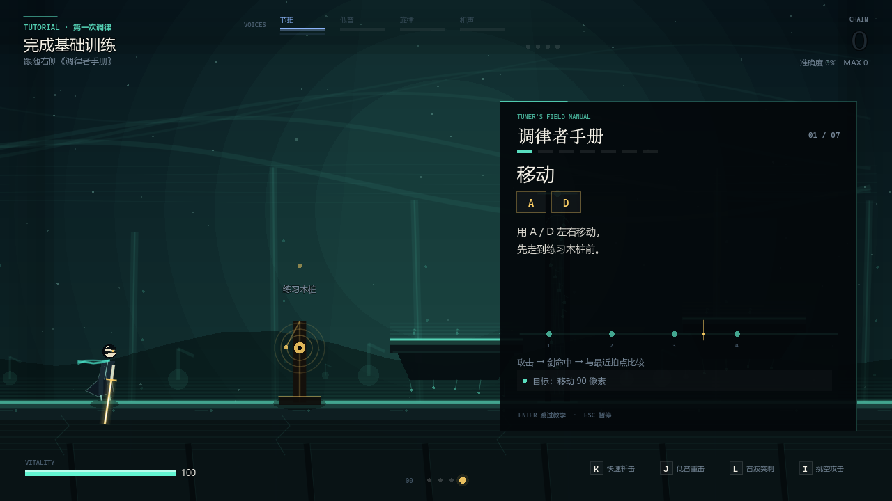 | 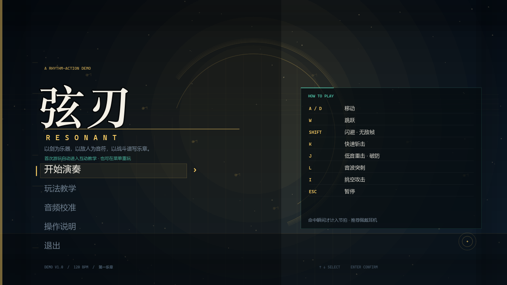 |

| 游戏 | 共鸣封印 |
|---|---|
| 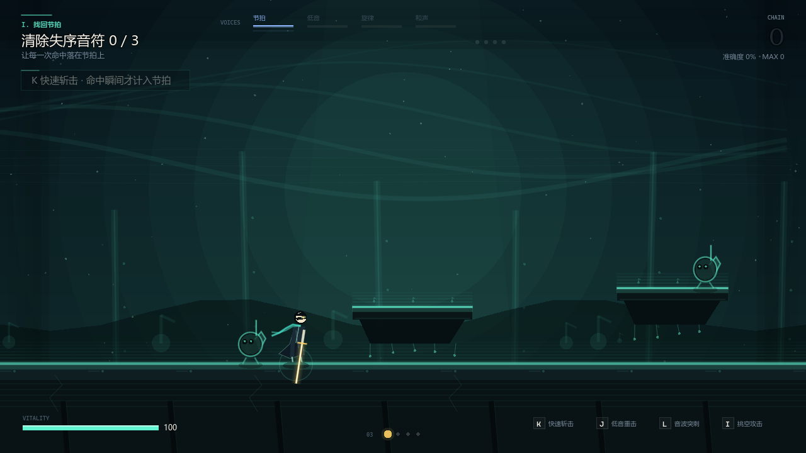 | 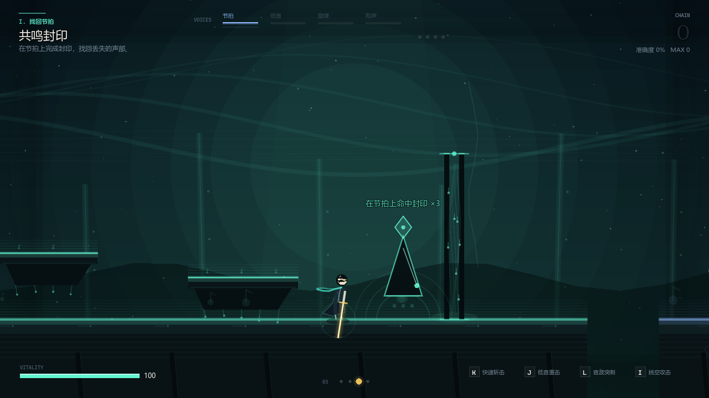 |

| 机械大厅 | 失序区域 |
|---|---|
| 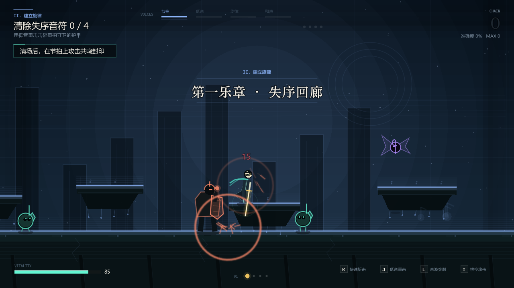 | 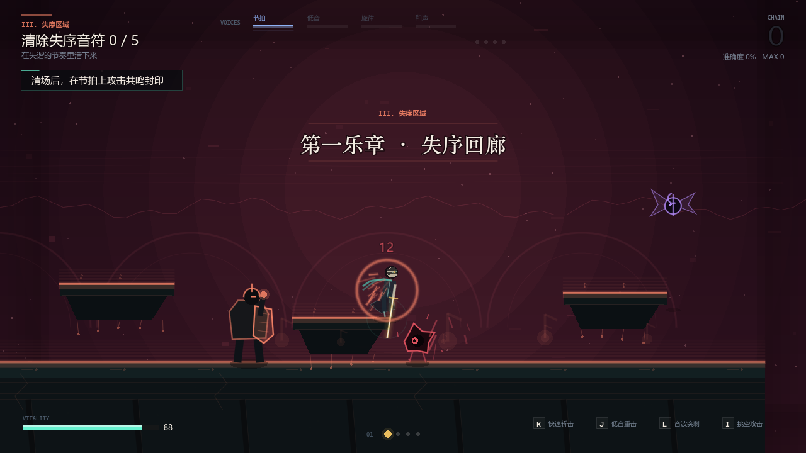 |

| Boss | 终章演奏 |
|---|---|
| 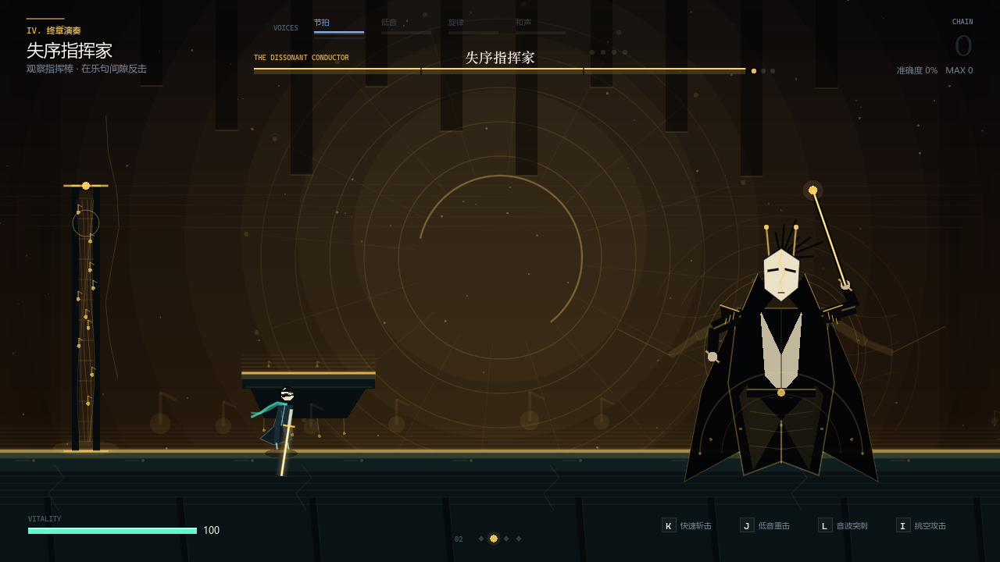 | 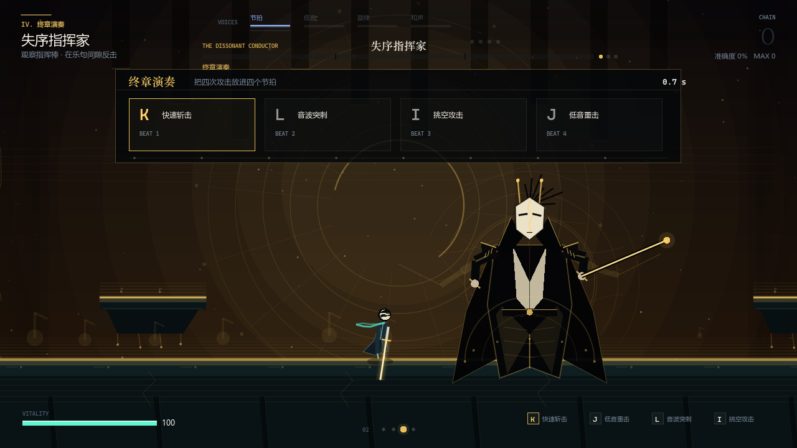 |

| 完美乐章 | 操作说明 |
|---|---|
| 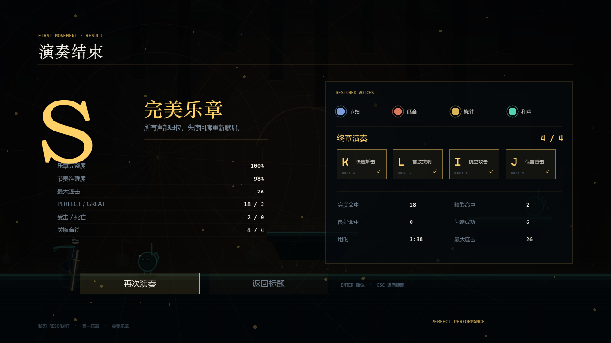 | 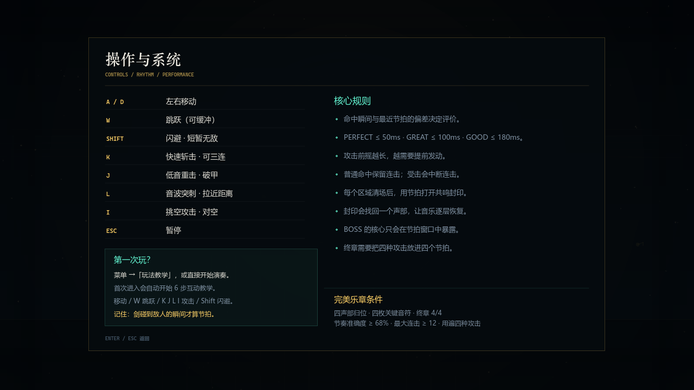 |

| 音频校准 | 暂停 |
|---|---|
| 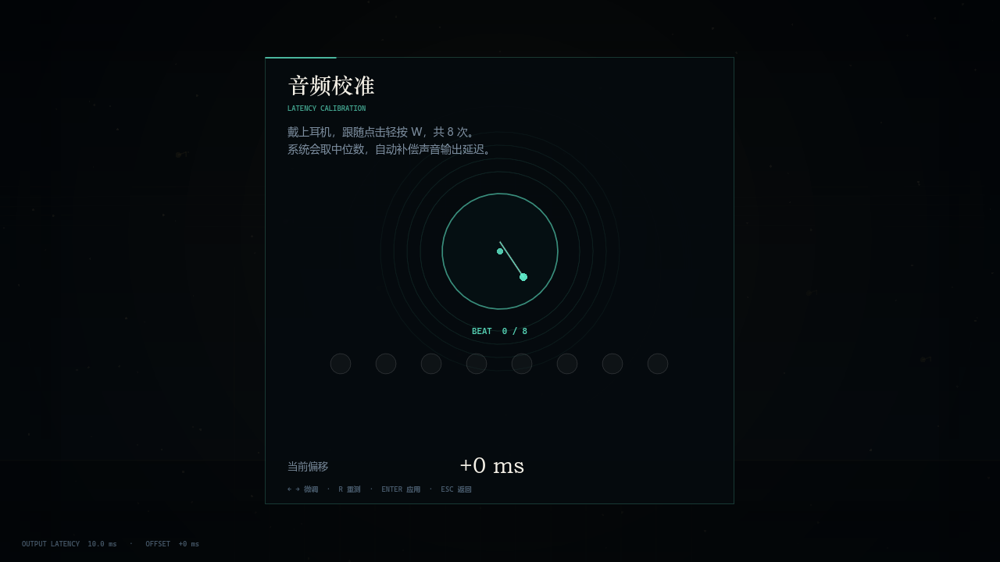 | 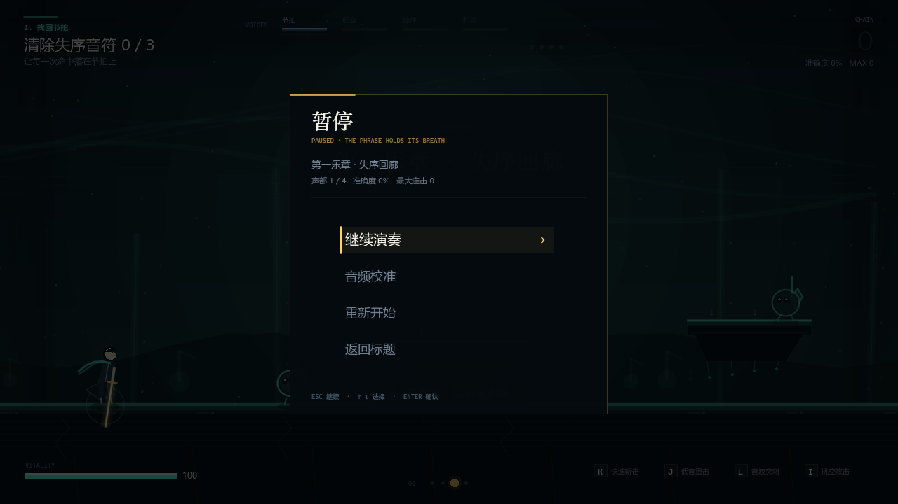 |

---

*Godot 4.7.2 · 1280×720 · 120 BPM · 全程序绘制与合成音频。*
